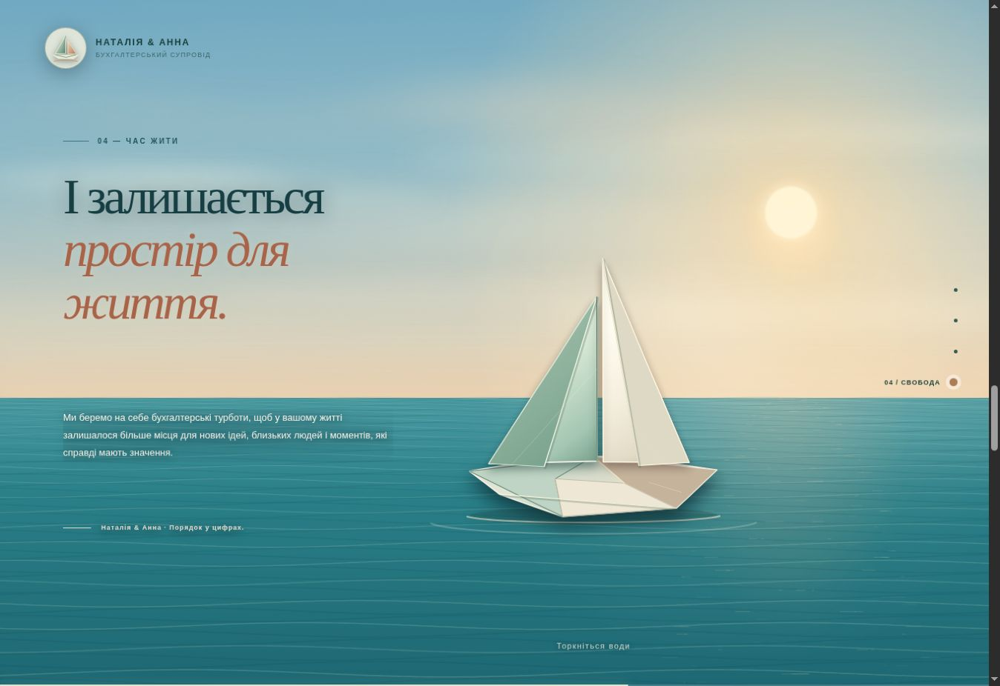
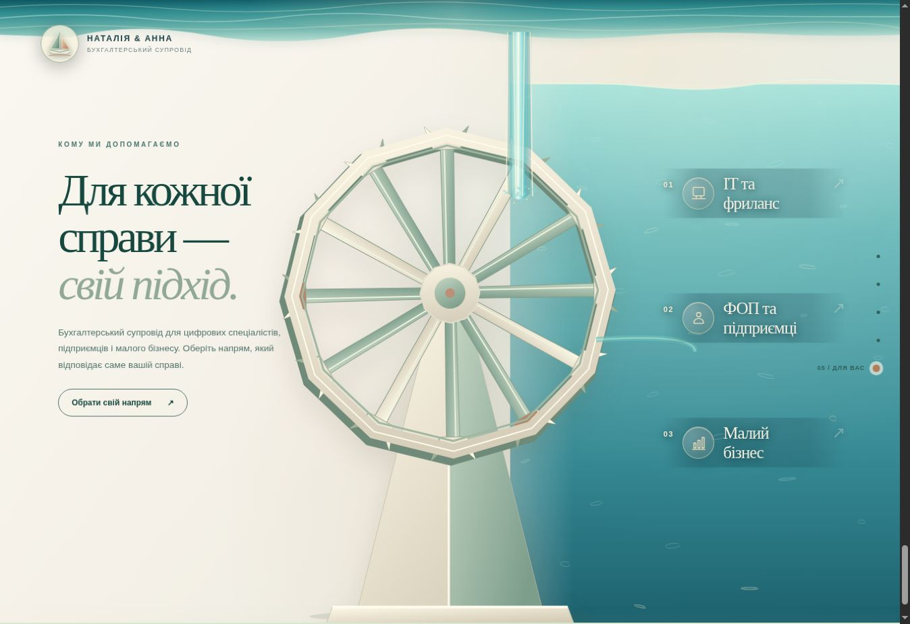

# Наталія & Анна — паперові вітрила

Статичний сайт для GitHub Pages. Three.js 0.165.0 і GSAP 3.15.0 завантажуються з CDN; збирання не потрібне.

## Версія 44

Після складання кораблика четверта сцена зупиняється на завершеній композиції. Наступне прокручування пересуває її вліво й відкриває паперовий млин праворуч. Вода приводить колесо в рух, заповнює праву частину та відкриває напрями послуг.

- Кораблик: відкритий складений корпус, велике вітрило кольору слонової кістки, менше шавлієве вітрило; окремі вершини на стиках запобігають розтягнутим полігонам.
- Море: геометричні хвилі, відображення кораблика, плавне погойдування від тієї самої хвилі, дотик/натискання створює кільцевий імпульс. Є кнопка для клавіатури.
- Млин: паперові обід, спиці й відкриті лопаті; постійний потік та обертання за годинниковою стрілкою. Рівень води залежить від скролу.
- На вузькому екрані колесо зменшується, а потік оминає заголовок. За `prefers-reduced-motion` хвилі нерухомі, горизонтальна панорама замінюється прямим перемиканням.
- Якщо WebGL недоступний, працюють Canvas/SVG, хвилі від натискання, горизонтальний перехід і кнопки послуг.

`scene04-lab.html` відкриває окрему панель перегляду четвертої сцени й переходу.

## Перевірка

```sh
node --test tests/story-timeline.test.mjs tests/paper-boat-shape.test.mjs
```

Вісім тестів перевіряють зворотний хід, стикування панелей, переходи з навігації, режим зменшеного руху, глибоке посилання та цілісність поверхонь кораблика.

Під час підготовки v44 у браузері перевірені Canvas/SVG, натискання на воду, перехід в обидва боки, рух колеса без скролу та вибір послуг; окремо перевірене компонування 390 × 844. У цьому браузері WebGL вимкнений, тому кінцевий вигляд GPU-відображень потребує перевірки на пристрої з WebGL перед злиттям у `main`.

Старі `*-smoke.mjs` описують попередні експериментальні версії й не є перевіркою v44. Поточна реалізація не підключає відео млина та попередній `ocean-to-wheel-bridge-v43.js`; файли збережені для історичних прототипів.

Знімки перевіреного резервного режиму Canvas/SVG (не GPU-рендер):




